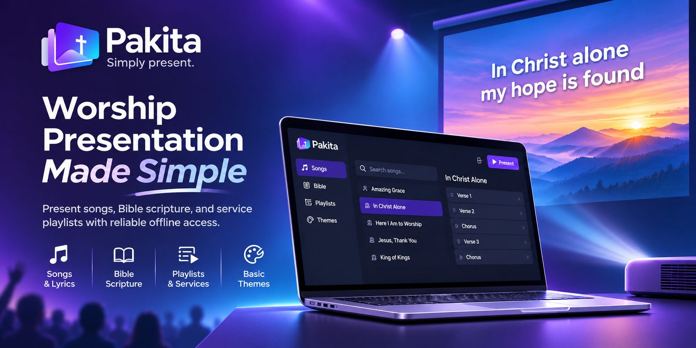

# Pakita



**Simply present.**

Pakita is a free, open-source worship presentation app for churches: song
lyrics, Bible passages, service playlists and simple themes, presented from a
laptop to a projector.

Content is managed on the church's own server and synchronised to each
laptop, so a service can be presented with no internet connection.

> Pakita is in early development. It is not ready for use yet.

## Repository

| Path | What it is |
|---|---|
| `apps/api` | The church's server: NestJS, Prisma and PostgreSQL |
| `apps/desktop` | The presenter app: Electron and Vue |
| `deploy` | A church's server: Docker Compose and its scripts |

## Run a server

A church runs its own Pakita server with Docker Compose: see
[`deploy/README.md`](deploy/README.md). Desktop installers are on the
[releases page](https://github.com/jaylordibe/pakita/releases).

## Develop locally

**You need:** Node 24 (see `.nvmrc`), pnpm through Corepack
(`corepack enable pnpm`), and Docker with Compose for the API's database,
Redis and object storage.

```bash
pnpm install

# API — starts the local Postgres, Redis and storage, then the API.
# Copy apps/api/.env.example to apps/api/.env first and fill it in.
pnpm --filter @pakita/api stack:up
pnpm --filter @pakita/api prisma:deploy   # the database schema
pnpm --filter @pakita/api prisma:seed     # roles, plus a sign-in admin and user
pnpm --filter @pakita/api start:dev

# Desktop — the Electron app with hot reload.
pnpm --filter @pakita/desktop dev
```

### Try the whole app

With the API running, fill your local server with a sample church:

```bash
pnpm --filter @pakita/api seed:sample
```

It adds **Grace Community Church** with five public-domain hymns (two with
a short arrangement), two themes (Evening is the default), a few World
English Bible passages and a **Sunday Service** playlist for the coming
Sunday. Running it again changes nothing. It is for development only: it
refuses `NODE_ENV=production`, and a church server never runs it.

In the desktop app, connect to **`http://localhost:3000`** (the API's
`PORT`; plain `http` is accepted only for a server on this computer).

Pakita has two levels of account. **Church accounts** are a church's own
people: each is a member of a church with one church role, and sees only
that church. These are the sample church's, all with the password
**`grace-church-1`**:

| Church role | Email | What they can do in the church |
|---|---|---|
| Owner | `owner@gracechurch.example.com` | Everything, including deleting the church and handing it over |
| Admin | `admin@gracechurch.example.com` | Everything else: the library, the members and their roles |
| Manager | `manager@gracechurch.example.com` | The library (songs, themes, playlists); can add members but not change roles |
| Staff | `staff@gracechurch.example.com` | Presents the library; changes nothing (the usual volunteer) |

**Platform accounts** run the server itself and belong to no church.
`prisma:seed` creates them from the `SEED_*` values in `apps/api/.env`
(below are the defaults in `apps/api/.env.example`):

| Platform role | Email | Password | What it is for |
|---|---|---|---|
| Platform admin | `admin@example.com` | `admin-local-dev-1` | Server staff: imports and publishes Bibles for every church, administers users and churches |
| None | `user@example.com` | `user-local-dev-1` | An account with no church yet: try creating a church from scratch |

To try a service, sign in as the **staff** or **manager** account.

Then walk through a Sunday as the media team would:

1. Choose **Grace Community Church**. The laptop downloads the library.
2. **Songs**: open *Amazing Grace*, switch the arrangement to *Short*, and
   press **Go live**. Move with the arrow keys or Space; press **B** for
   blackout. A second display shows the projector; with one screen it opens
   in a window.
3. **Bible**: search `so loved`, open John 3:16, shift-click verse 17, and
   go live with the reference shown beneath.
4. **Playlists**: open *Sunday Service*, check every entry is ready on this
   laptop, and **Present playlist** to run the whole service as one deck.
5. **Themes** (manager and above): edit *Evening* and watch the preview.
6. Stop the API and present again: everything still works offline.

Managers and above also add songs and build playlists; staff see the same
library but cannot change it. Importing a full Bible from USFM files
(eBible.org downloads work) is the platform admin's job.

Tests, lint and the other commands, and which of them each change must
pass, are listed in each app's `AGENTS.md`:
[`apps/api/AGENTS.md`](apps/api/AGENTS.md) and
[`apps/desktop/AGENTS.md`](apps/desktop/AGENTS.md).

## Licence

Pakita is licensed under the [GNU Affero General Public License v3.0 or
later](LICENSE). See [`NOTICE`](NOTICE) for third-party notices.
